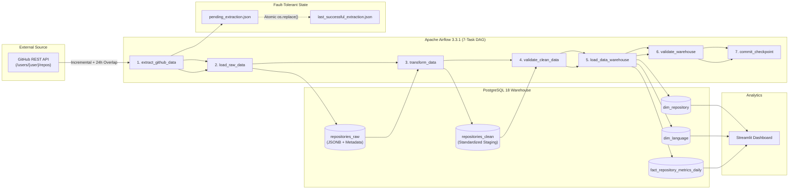

# GitHub Repository Analytics ETL Pipeline

An end-to-end, containerized **Incremental Data Engineering Pipeline** orchestrated with **Apache Airflow 3.3.1** and **PostgreSQL 18**. It extracts repository metadata from the GitHub REST API using watermark-based incremental ingestion, enforces multi-layer data quality gates, models daily metrics into a star-schema warehouse, and serves analytics via a Streamlit dashboard.

---

## Architecture Overview



---

## Key Engineering Highlights

* **Incremental Ingestion with Atomic Checkpointing:**
  * Performs a full initial load, followed by incremental runs using `updated`-descending pagination with a **24-hour overlap window** to catch late-arriving API updates.
  * Writes a candidate watermark to `pending_extraction.json` during extraction and atomically promotes it via `os.replace()` **only after** all downstream load, transform, and quality tasks succeed—preventing data loss on partial failures.
* **Modular Airflow 3 Orchestration:**
  * Decomposed into 7 isolated `BashOperator` tasks (`extract` -> `load_raw` -> `transform` -> `validate_clean` -> `load_warehouse` -> `validate_warehouse` -> `commit_checkpoint`) with exponential retry backoff and `max_active_runs=1` concurrency protection.
* **Star-Schema Data Warehouse (PostgreSQL 18):**
  * **`dim_repository`**: Slowly updated repository metadata (`repository_id`, `repository_name`, `full_name`, `created_at`).
  * **`dim_language`**: Conformed programming language lookup (`language_id`, `language_name`).
  * **`fact_repository_metrics_daily`**: Idempotent daily snapshots (`(repository_id, snapshot_date)` composite primary key) tracking `stars`, `forks`, and `repository_age_days`.
* **Two-Stage Data Quality Gates:**
  * **Staging Validation (`scripts/validate.py`):** Verifies zero duplicate IDs, non-null names/languages, non-negative metrics, valid temporal ordering (`updated_at >= created_at`), and 100% batch ID reconciliation against raw payloads.
  * **Warehouse Validation (`scripts/validate_warehouse.py`):** Enforces referential integrity across fact and dimension tables, snapshot completeness, and day-over-day volume anomaly checks.
* **Centralized Observability & Automated Testing:**
  * Unified rotating file + stdout logging (`scripts/logger.py`), domain-specific exception hierarchy (`scripts/exceptions.py`), and `pytest` unit test coverage (`tests/`).

---

## Project Structure

```text
├── dags/
│   └── github_repository_analytics_etl.py   # Airflow 3 DAG (7 modular tasks)
├── dashboard/
│   └── app.py                               # Streamlit analytics app
├── data/
│   ├── raw/                                 # Extracted JSON batches
│   └── state/                               # Atomic extraction watermarks
├── scripts/
│   ├── extract.py                           # GitHub API incremental extractor
│   ├── load_raw.py                          # Raw PostgreSQL upsert
│   ├── transform.py                         # Pandas cleaning & age calculation
│   ├── validate.py                          # Staging data quality checks
│   ├── load_warehouse.py                    # Star-schema dimension & fact loader
│   ├── validate_warehouse.py                # Warehouse referential & volume checks
│   ├── run_pipeline.py                      # Standalone runner & checkpoint committer
│   ├── logger.py                            # Centralized rotating logger
│   ├── exceptions.py                        # Custom exceptions & DB engine factory
│   └── db_connection.py                     # PostgreSQL connection healthcheck
├── sql/                                     # DDL schema definitions
├── tests/                                   # Pytest unit test suite
├── compose.yaml                             # Multi-container Docker Compose stack
├── Dockerfile                               # ETL pipeline container image
├── Dockerfile.airflow                       # Custom Airflow 3.3.1 image
├── pytest.ini                               # Pytest path configuration
└── requirements.txt                         # Python dependencies
```

---

## Quick Start

### 1. Configure Environment Variables
Create a `.env` file in the project root:
```env
GITHUB_USERNAME=microsoft
GITHUB_TOKEN=your_github_pat_optional

DB_HOST=localhost
DB_PORT=5433
DB_NAME=github_analytics
DB_USER=postgres
DB_PASSWORD=postgres
```

### 2. Start Services with Docker Compose
```bash
docker compose up -d --build
```
* **Airflow UI:** `http://localhost:8080`
* **PostgreSQL:** `localhost:5433`

### 3. Run Locally or Execute Tests
```bash
# Run full pipeline locally
python -m scripts.run_pipeline

# Run unit test suite
pytest

# Launch Streamlit dashboard
streamlit run dashboard/app.py
```