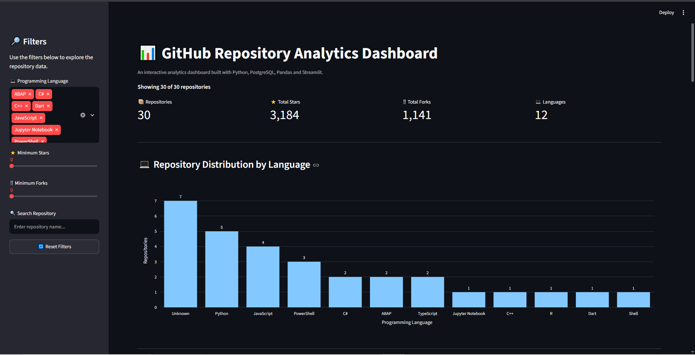
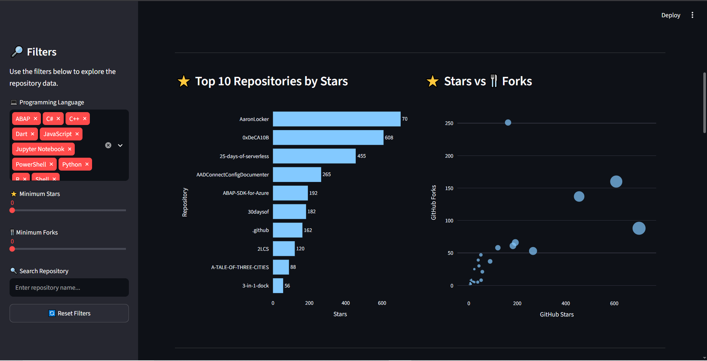
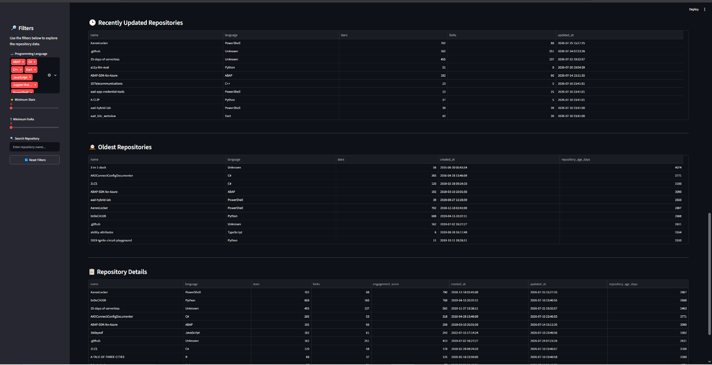

📊 GitHub Repository Analytics ETL Pipeline

An end-to-end Data Engineering project that extracts GitHub repository data, stores raw data, loads it into PostgreSQL, transforms and validates the data using Python and Pandas, performs SQL-based analysis, and presents the results through an interactive Streamlit dashboard.

📌 Project Overview

This project demonstrates a complete ETL (Extract, Transform, Load) data engineering workflow using GitHub repository data.

The pipeline:

Extracts repository data from the GitHub API
Stores the extracted data as raw JSON
Loads the raw data into PostgreSQL
Cleans and transforms the data using Pandas
Stores the cleaned data in PostgreSQL
Validates the quality of the transformed data
Performs analytical queries using SQL
Displays the results through an interactive Streamlit dashboard

The project demonstrates how raw API data can be transformed into structured data and useful analytical insights.

🏗️ Project Architecture

                    GitHub API
                        │
                        ▼
                 ┌─────────────┐
                 │  extract.py │
                 └──────┬──────┘
                        │
                        ▼
                 Raw JSON Data
                 data/raw/
                        │
                        ▼
                ┌────────────────┐
                │  load_raw.py   │
                └───────┬────────┘
                        │
                        ▼
                   PostgreSQL
                  Raw Repository
                       Data
                        │
                        ▼
                ┌────────────────┐
                │  transform.py  │
                └───────┬────────┘
                        │
                        ▼
               Cleaned Repository
                       Data
                        │
                        ▼
                 PostgreSQL
                        │
                        ▼
                ┌────────────────┐
                │   validate.py  │
                └───────┬────────┘
                        │
                        ▼
                 Data Validation
                        │
                        ▼
                 ┌──────────────┐
                 │ analysis.sql │
                 └──────┬───────┘
                        │
                        ▼
                Analytical Results
                        │
                        ▼
              ┌───────────────────┐
              │ Streamlit         │
              │ Dashboard         │
              └───────────────────┘

🔄 ETL Pipeline
1. Extract

extract.py retrieves GitHub repository information through the GitHub API.

The extracted information includes fields such as:

Repository ID
Repository name
Programming language
Stars
Forks
Creation date
Last updated date

The raw response is stored in:

data/raw/repos.json

2. Load Raw Data

load_raw.py loads the extracted raw data into PostgreSQL.

This provides a persistent database layer for the pipeline.

3. Transform

transform.py cleans and transforms the repository data using Pandas.

The transformation process includes preparing fields such as:

Repository name
Programming language
Stars
Forks
Creation date
Updated date
Repository age

The cleaned data is stored in the PostgreSQL table:

repositories_clean
4. Validate

validate.py performs data quality checks before the data is used for analysis.

The validation checks include:

Total repository count
Duplicate repository IDs
Missing repository names
Negative star values
Negative fork values
Missing programming languages

Example validation result:

DATA VALIDATION

Total repositories: 30
Duplicate IDs: 0
Missing repository names: 0
Negative stars: 0
Negative forks: 0
Missing languages: 0

DATA VALIDATION PASSED

🗄️ Database

The project uses PostgreSQL as the main database.

The cleaned repository table contains fields including:

| Column                | Description              |
| --------------------- | ------------------------ |
| `id`                  | GitHub repository ID     |
| `name`                | Repository name          |
| `language`            | Programming language     |
| `stars`               | Number of GitHub stars   |
| `forks`               | Number of GitHub forks   |
| `created_at`          | Repository creation date |
| `updated_at`          | Last update date         |
| `repository_age_days` | Repository age in days   |

📈 SQL Analysis

The project contains analytical SQL queries in:

sql/analysis.sql

The analysis includes:

Top repositories by stars

Identifies the 10 repositories with the highest number of stars.

Repository count by programming language

Shows how many repositories belong to each programming language.

Top repository by each language

Uses SQL window functions to identify the highest-starred repository within each programming language.

Average stars and forks by language

Calculates:

Repository count
Average stars
Average forks

for each programming language.

Repository engagement

An engagement score is calculated using:

engagement_score = stars + forks

This identifies repositories with high overall community engagement.

Oldest repositories

Finds repositories with the highest repository age.

Recently updated repositories

Identifies repositories with the most recent update timestamps.

📊 Streamlit Dashboard

The project includes an interactive Streamlit dashboard for exploring the repository data.

The dashboard provides:

Total repositories
Total stars
Total forks
Number of programming languages
Repository count by programming language
Top repositories by stars
Stars vs forks analysis
Top repositories by engagement
Recently updated repositories
Oldest repositories
Interactive Filters

The dashboard allows users to filter the data using:

Programming language
Minimum stars
Minimum forks
Repository name search

A reset button is also provided to restore the default filters.

🖼️ Dashboard Screenshots
Dashboard Overview

Repository Analysis

Recently Updated and Oldest Repositories

🛠️ Technologies Used

| Technology    | Purpose                          |
| ------------- | -------------------------------- |
| Python        | ETL pipeline and data processing |
| GitHub API    | Source of repository data        |
| Pandas        | Data transformation              |
| PostgreSQL    | Data storage                     |
| SQL           | Data analysis                    |
| Streamlit     | Interactive dashboard            |
| Plotly        | Data visualization               |
| SQLAlchemy    | PostgreSQL connection            |
| python-dotenv | Environment variable management  |
| Git & GitHub  | Version control                  |

📁 Project Structure

GitHub Repository Analytics ETL Pipeline/
│
├── dashboard/
│   └── app.py
│
├── data/
│   ├── raw/
│   │   └── repos.json
│   │
│   └── cleaned/
│
├── docs/
│   └── screenshots/
│
├── scripts/
│   ├── db_connection.py
│   ├── extract.py
│   ├── load_raw.py
│   ├── run_pipeline.py
│   ├── transform.py
│   └── validate.py
│
├── sql/
│   └── analysis.sql
│
├── .gitignore
├── README.md
├── requirements.txt
└── run.py
.env and .venv are excluded from version control using .gitignore.

⚙️ Installation
1. Clone the repository
git clone https://github.com/rajbirdatta/github-repository-analytics-etl-pipeline.git

Move into the project directory:

cd github-repository-analytics-etl-pipeline
2. Create a virtual environment
python -m venv .venv

Activate it on Windows:

.venv\Scripts\Activate.ps1
3. Install dependencies
pip install -r requirements.txt
🔐 Environment Variables

Create a .env file in the project root.

Example:

DB_USER=your_postgresql_username
DB_PASSWORD=your_postgresql_password
DB_HOST=localhost
DB_PORT=5432
DB_NAME=github_pipeline

GITHUB_TOKEN=your_github_token

Replace the values with your own credentials.

Never commit the .env file to GitHub.

▶️ Running the ETL Pipeline

The recommended way to run the complete pipeline is:

python run.py

This runs the pipeline components in sequence:

Extract
   ↓
Load Raw Data
   ↓
Transform
   ↓
Validate
   ↓
Pipeline Complete

A successful execution should finish with:

ETL PIPELINE COMPLETED SUCCESSFULLY!
📊 Running the Dashboard

After the database has been populated, start the Streamlit dashboard:

streamlit run dashboard/app.py

The dashboard will open in your browser.

Usually it will be available at:

http://localhost:8501
🔍 Example Insights

The dashboard and SQL analysis can be used to answer questions such as:

Which programming languages have the most repositories?
Which repositories have the most stars?
Which repositories have the highest engagement?
What is the relationship between stars and forks?
Which repositories were updated most recently?
Which repositories are the oldest?
Which programming languages have the highest average number of stars?
Which repository is the most popular within each programming language?
✅ Data Validation

The pipeline includes a dedicated validation stage to ensure that the transformed data is suitable for analysis.

The validation process checks for:

✓ Duplicate repository IDs
✓ Missing repository names
✓ Negative star values
✓ Negative fork values
✓ Missing programming languages

The current pipeline successfully passes these validation checks.

🚀 Future Improvements

Possible improvements for future versions include:

Automated scheduled pipeline execution
GitHub Actions CI/CD
Incremental data loading
Historical repository tracking
More advanced engagement metrics
Additional dashboard visualizations
Repository activity trends over time
Automated data-quality reporting
Cloud database deployment
Streamlit Cloud deployment
🎯 Project Goals

This project was created to demonstrate practical skills in:

ETL pipeline development
API data extraction
Data cleaning and transformation
PostgreSQL database management
SQL analytics
Data validation
Data visualization
Dashboard development
Python project organization
Git and GitHub version control
👨‍💻 Author

Rajbir Datta

GitHub: [Rajbir Datta](https://github.com/rajbirdatta)

📄 License

This project is intended for educational and portfolio purposes.